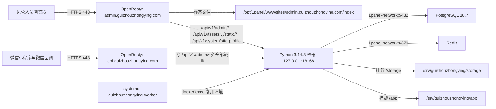

# 贵州众赢生产环境标准部署指南（1Panel v2.5.1 原生源码版）

本指南面向 **1Panel 社区版 v2.5.1 原生网页运行环境 + `pip` + `requirements.txt`** 的单机源码部署路线，完整涵盖本地打包、PostgreSQL 迁移、Python 3.14.8 运行环境、常驻 Worker、双域名 OpenResty HTTPS 站点、线上验收与日常快速更新，并汇总了各阶段实操避坑点。

如采用仓库固定 Compose 模板与宿主机 `uv` 二进制方案，请参见 [1Panel 单机源码部署手册](1panel-source-deployment.md)。

**安全边界**：所有密码、JWT 密钥、到店核销 Fernet 密钥与微信支付私钥仅在生产受控环境配置并离线备份，严禁写入源码或提交至仓库。

---

## 1. 生产架构与环境基线

### 1.1 服务器与基础组件规格

| 项目 | 实际配置基线 | 说明 |
| --- | --- | --- |
| 操作系统与磁盘 | Ubuntu Linux（`x86_64`），单系统盘挂载 `/` | 终端默认非 root 用户（如 `ubuntu`）操作 Docker 和 systemd 需加 `sudo` |
| 运维面板 | 1Panel 社区版 v2.5.1 | 网页端管理数据库、文件、容器、证书与网站 |
| OpenResty | 1Panel 应用商店安装，`host` 网络模式 | 容器仅挂载 `/opt/1panel/www` 至 `/www`，未挂载 `/srv` |
| PostgreSQL | 1Panel 应用商店安装，`18.7-alpine` | 仅监听 `127.0.0.1:5432`，公网不可直连，远程管理统一走 SSH 隧道 |
| Redis | 1Panel 应用商店安装 | 仅监听 `127.0.0.1:6379`，与后端在 `1panel-network` 内网通信 |
| Backend（FastAPI） | 1Panel「网站 -> 运行环境 -> Python `3.14.8`」 | 容器名 `guizhouzhongying-backend`，仅监听 `127.0.0.1:18168`，不打包业务镜像 |
| 常驻 Worker | 宿主机 `systemd` 服务 `guizhouzhongying-worker` | 通过 `docker exec` 复用 Backend 容器内的 `/app/.venv` 与环境变量 |
| Admin 管理后台 | 1Panel OpenResty 静态网站 | 域名 `https://admin.guizhouzhongying.com`，同域反代后台与公共站点资料接口 |
| 小程序与公开 API | 1Panel OpenResty 反向代理网站 | 域名 `https://api.guizhouzhongying.com`，反代至 `127.0.0.1:18168` 并屏蔽 `/api/v1/admin/` |
| Web 端（`apps/web`） | 永久停用冻结 | 严禁部署、启动或开放 `3000` 端口 |

### 1.2 线上流量与目录拓扑



### 1.3 宿主机目录分工

```text
/srv/guizhouzhongying/
├── app/                     # 后端源码与容器自动生成的 .venv（权限 0755）
├── storage/
│   ├── uploads/             # 线上业务上传文件：商品图、分类图标、头像（权限 0755）
│   └── settings-media/      # 线上系统设置媒体：站点 LOGO，与 uploads 同级不嵌套（权限 0755）
└── secrets/
    └── wechat/              # 预留微信支付商户私钥与微信支付公钥目录（权限 0700）

/opt/1panel/www/sites/admin.guizhouzhongying.com/index/
                             # 管理后台纯静态构建产物（apps/admin/dist 内容）
```

**注意事项与避坑点**：

- 1Panel 应用商店安装的 OpenResty 容器默认只挂载了 `/opt/1panel/www` 至 `/www`，没有挂载 `/srv`。管理后台静态构建产物必须放在 `/opt/1panel/www/sites/admin.guizhouzhongying.com/index/`，放到 `/srv` 下会导致 OpenResty 找不到文件返回 404。
- 业务上传目录 `uploads/`、`settings-media/` 与密钥目录必须与 `/srv/guizhouzhongying/app/` 源码目录分开，防止更新代码时误删线上图片或泄露私钥。
- `uploads` 与 `settings-media` 必须是互不嵌套的同级目录，后端启动时会执行严格路径校验。

---

## 2. 阶段一：本地准备发布包

### 2.1 导出锁定版本的 `requirements.txt` 并打包后端源码

线上使用 `pip` 安装依赖，但版本清单必须从本地 `apps/backend/uv.lock` 精确导出，防止线上依赖漂移：

```powershell
cd apps/backend
uv export --frozen --no-dev --no-hashes -o requirements.txt
```

将 `apps/backend` 中以下 **6 项** 打包为 `backend.zip`：

- `alembic/`
- `alembic.ini`
- `app/`
- `scripts/`
- `pyproject.toml`
- `requirements.txt`（刚导出的临时文件）

打包完成后删除本地 `apps/backend/requirements.txt`，不要提交进 Git，仓库继续保持 `uv.lock` 作为唯一 Python 锁文件。

**注意事项与避坑点**：

- **禁止直接压缩整个仓库目录上传**：本地工作区包含 `node_modules`、Windows 版 `.venv`（Linux 无法运行）、本地开发 `.env` 与测试缓存，不仅体积庞大，还会污染线上环境。
- **禁止在线上无锁定升级依赖**：每次增减 Python 包都应先在本地用 `uv add` 更新 `uv.lock`，再重新导出 `requirements.txt` 同步至线上。

### 2.2 编译并打包 Admin 管理后台静态产物

在仓库根目录执行：

```powershell
pnpm install --frozen-lockfile
pnpm --filter @pinjie/admin build
```

进入 `apps/admin/dist/`，全选内部所有文件和目录打包为 `admin-dist.zip`（确保解压后直接可见 `index.html`，不要多套一层 `dist/` 目录）。

### 2.3 （仅首次空库初始化）本地用 pgAdmin 4 导出初始 SQL

如需把本地开发库已维护的基础资料（一级分类、分类图标绑定、权限目录、基础商品与系统设置）迁到线上空库：

1. 在 pgAdmin 4 左侧展开 **Servers -> 本地服务 -> Databases**，右键开发库选择 **Backup...（备份...）**。
2. **General（常规）** 标签页：
   - **Filename**：保存为 `guizhouzhongying_init.sql`。
   - **Format**：选择 **`Plain`（纯文本）**。
   - **Encoding**：选择 **`UTF8`**。
3. **Data Options（数据选项）**（旧版在 Dump options）标签页：
   - 在 **Do not save（不保存）** 区域开启 **`Owner`（所有者）** 与 **`Privileges`（权限）**。
   - 不要勾选 `Only schema` 或 `Only data`。
4. 点击 **Backup** 完成导出。

**注意事项与避坑点**：

- **PostgreSQL 跨版本兼容**：若本地 PG 版本高于线上 PG 版本（例如本地 18、线上 16），需手动删掉导出 SQL 开头的 `\restrict ...`、`SET transaction_timeout = 0;` 以及文件最末尾对应的 `\unrestrict ...` 共 3 行。线上为 `18.7-alpine`（不低于本地 `18.1 / 18.4`）时无需删改。
- **避免带入测试脏交易**：若本地开发库存在未核销到店测试订单，其核销码使用本地 `LOCAL_REDEMPTION_KEY` 加密，换线上新密钥后无法解密，且 7 天后线上 Worker 会触发自动退款。正式营业前应确保订单和支付表干净。

---

## 3. 阶段二：准备数据库、导入初始数据与同步图片

### 3.1 建立宿主机目录与生产数据库

1. 在 1Panel **「主机 -> 文件」** 建好 `/srv/guizhouzhongying/{app,storage/uploads,storage/settings-media,secrets/wechat}`：
   - `guizhouzhongying`、`app`、`storage`、`uploads`、`settings-media` 保持默认权限 **`0755`**。
   - `secrets` 和 `secrets/wechat` 权限设为 **`0700`**。
2. 在 **「数据库 -> PostgreSQL -> 创建」** 新建数据库 `guizhouzhongying_prod`、业务用户名 `guizhouzhongying_prod` 与强密码。
3. 在 **「数据库 -> Redis」** 记下 Redis 密码；在 **「容器 -> 容器」** 记下 PostgreSQL 容器名（如 `<PostgreSQL容器名>`）与 Redis 容器名（如 `<Redis容器名>`）。

### 3.2 导入初始 SQL 到线上空库

- **方式 A（1Panel 网页导入，推荐）**：将本地 `guizhouzhongying_init.sql` 用 7-Zip（`gzip` 格式）压为 **`guizhouzhongying_init.sql.gz`**，在 **「数据库 -> PostgreSQL -> `guizhouzhongying_prod` -> 导入备份」** 上传恢复。
- **方式 B（1Panel 网页「主机 -> 终端」精确导入）**：直接通过 `psql` 严格导入并查看实时输出：

```bash
sudo docker exec -i -e PGPASSWORD='<业务库密码>' <PostgreSQL容器名> \
  psql -v ON_ERROR_STOP=1 -U guizhouzhongying_prod -d guizhouzhongying_prod \
  < /opt/1panel/uploads/database/postgresql/postgresql/guizhouzhongying_prod/guizhouzhongying_init.sql
```

导入完成后核验表数量、迁移版本与超管账号，并清理临时 SQL 文件：

```bash
sudo docker exec -i <PostgreSQL容器名> psql -U guizhouzhongying_prod -d guizhouzhongying_prod \
  -c "SELECT count(*) AS table_count FROM information_schema.tables WHERE table_schema='public'; SELECT * FROM alembic_version; SELECT username, is_superuser, is_active FROM admins;"

sudo rm -f /opt/1panel/uploads/database/postgresql/postgresql/guizhouzhongying_prod/guizhouzhongying_init.sql
```

**注意事项与避坑点**：

- **1Panel 网页直接上传纯 `.sql` 报 `恢复 失败: exit status 1`**：1Panel 后台恢复链路原生面向 `pg_dump | gzip` 生成的 `.sql.gz` 压缩流。后续从外部导入请先压缩为 `.sql.gz`，日常线上备份与恢复直接使用 1Panel 自带备份功能即可正常回滚和还原。
- **执行 `docker` 报 `permission denied`**：终端默认登录为普通用户（如 `ubuntu`），执行 `docker`、`systemctl` 等命令前需加 `sudo`。
- **优先使用业务用户导入**：使用 `guizhouzhongying_prod` 导入，确保全部业务表属主归业务用户，避免后续 Alembic 迁移或应用读写报权限不足。
- **本地 pgAdmin 4 通过 SSH 隧道连线上库报 `Role does not exist`**：先在服务器终端执行 `sudo docker exec -i <PostgreSQL容器名> sh -c 'psql -U "${POSTGRES_USER:-postgres}" -d postgres -c "\du"'` 核对真实角色名，pgAdmin 4 的 `Connection -> Username` 必须填写实际存在的用户名。
- **上线后严禁本地库覆盖线上库**：整库导入仅限首次空库初始化，一旦开始运营，后续升级只允许执行 `alembic upgrade head` 增量结构迁移。

### 3.3 同步上传物理图片文件（无需改表数据）

后端数据库仅存储相对路径与站内路径（`assets.url` 为 `/static/uploads/...`，系统设置 LOGO 为 `site/logo-...` 相对路径），与磁盘路径及域名解耦：

1. 将本地 `apps/backend/uploads/` 下的全部子目录和文件保持原结构上传至 `/srv/guizhouzhongying/storage/uploads/`。
2. 将本地 `apps/backend/settings-media/` 下的文件（如 `site/`，无需上传本地 `.settings-media-*` 隐藏目录）上传至 `/srv/guizhouzhongying/storage/settings-media/`。

---

## 4. 阶段三：创建 1Panel 原生 Python 3.14.8 运行环境

### 4.1 上传源码并生成 5 个线上独立随机密钥

1. 在 1Panel **「主机 -> 文件」** 进入 `/srv/guizhouzhongying/app`，上传并解压 `backend.zip`，确认根目录直接可见 `app/`、`alembic/`、`alembic.ini`、`scripts/`、`requirements.txt`，然后删除 `backend.zip`。
2. 在 **「主机 -> 终端」** 生成 5 个线上独立密钥（**禁止复用本地开发密钥**，`LOCAL_REDEMPTION_KEY` 务必离线备份，已有未核销订单后禁止直接更换）：

```bash
python3 - <<'PY'
import base64, secrets
print("WEB_JWT_SECRET=" + secrets.token_urlsafe(48))
print("ADMIN_JWT_SECRET=" + secrets.token_urlsafe(48))
print("WEB_TOKEN_HMAC_KEY=" + secrets.token_urlsafe(48))
print("ADMIN_TOKEN_HMAC_KEY=" + secrets.token_urlsafe(48))
print("LOCAL_REDEMPTION_KEY=" + base64.urlsafe_b64encode(secrets.token_bytes(32)).decode("ascii"))
PY
```

### 4.2 在 1Panel 网页填写 Python 运行环境表单

进入 **「网站 -> 运行环境 -> Python -> 创建运行环境」**：

1. **名称**：`guizhouzhongying-backend`
2. **项目目录**：`/srv/guizhouzhongying/app`
3. **启动命令**（复制整行，零引号防转义冲突）：

   ```bash
   [ -x .venv/bin/uvicorn ] || (python -m venv .venv && .venv/bin/pip install --no-cache-dir -r requirements.txt -i https://pypi.tuna.tsinghua.edu.cn/simple) && exec .venv/bin/uvicorn app.main:app --host 0.0.0.0 --port 18168 --no-proxy-headers
   ```

4. **应用与版本**：`Python` + **`3.14.8`**（项目要求 `>=3.14,<3.15`，不要选 `3.15.0` 或早期 `3.14.0`）。
5. **容器名称**：`guizhouzhongying-backend`
6. **「端口」选项卡**：主机 `18168` -> 容器 `18168`，仅绑定 `127.0.0.1`（关闭外部访问）。
7. **「挂载」选项卡**：宿主机 `/srv/guizhouzhongying/storage` -> 容器 `/storage`（读写）。后续开启微信支付时再追加 `/srv/guizhouzhongying/secrets/wechat` -> `/secrets/wechat`（只读）。
8. **「主机映射」选项卡**：留空。
9. **「环境变量」选项卡**（不要给值加外层引号）：

```dotenv
PROJECT_NAME=贵州众赢 Backend
ENVIRONMENT=production
DEBUG=false
API_V1_STR=/api/v1
API_DOCS_ENABLED=false
AUTH_COOKIE_SECURE=true
RELEASE_VERSION=20261124-init
LOG_LEVEL=INFO
LOG_FILE_ENABLED=false
PYTHONDONTWRITEBYTECODE=1
PYTHONUNBUFFERED=1
DATABASE_URL=postgresql+asyncpg://guizhouzhongying_prod:<PG密码>@<PostgreSQL容器名>:5432/guizhouzhongying_prod
REDIS_MODE=required
REDIS_URL=redis://:<Redis密码>@<Redis容器名>:6379/0
WEB_ORIGINS=["https://api.guizhouzhongying.com"]
ADMIN_ORIGINS=["https://admin.guizhouzhongying.com"]
TRUSTED_HOSTS=["api.guizhouzhongying.com","admin.guizhouzhongying.com","127.0.0.1"]
TRUSTED_PROXY_CIDRS=["127.0.0.1/32"]
FORCE_HTTPS=false
JWT_ISSUER=guizhouzhongying
WEB_JWT_SECRET=<随机密钥1>
ADMIN_JWT_SECRET=<随机密钥2>
WEB_TOKEN_HMAC_KEY=<随机密钥3>
ADMIN_TOKEN_HMAC_KEY=<随机密钥4>
LOCAL_REDEMPTION_KEY=<随机Fernet密钥>
MINIAPP_LOGIN_ENABLED=false
WECHAT_APP_ID=
WECHAT_APP_SECRET=
MINIAPP_JWT_SECRET=
MINIAPP_TOKEN_HMAC_KEY=
WECHAT_PAY_ENABLED=false
WECHAT_PAY_RECOVERY_ENABLED=false
WECHAT_SHIPPING_ENABLED=false
UPLOAD_STORAGE_DRIVER=local
UPLOAD_LOCAL_ROOT=/storage/uploads
UPLOAD_BASE_URL=/static/uploads
UPLOAD_MAX_FILE_SIZE_MB=50
SETTINGS_MEDIA_ROOT=/storage/settings-media
SETTINGS_MEDIA_BASE_URL=/static/settings
```

点击 **「确认」**，首次启动会自动创建 `/app/.venv` 并通过清华源装齐依赖（约 1 分钟）。查看运行环境 **「日志」**，出现 `Application startup complete.` 与 `Uvicorn running on http://0.0.0.0:18168` 即表示就绪。

**注意事项与避坑点**：

- **不要直接填 `uvicorn ...`**：纯净镜像不含第三方依赖，会直接报 `uvicorn: not found` 并反复重启。
- **不要无条件把 `pip install` 写进启动命令**：每次重启都会重新联网检查依赖。使用 `[ -x .venv/bin/uvicorn ] || (...) && exec ...` 可做到首次自动安装、后续重启 1 秒启动且由 Uvicorn 接管 PID 1。
- **配置强校验**：`WEB_ORIGINS` 与 `ADMIN_ORIGINS` 不能重叠，`TRUSTED_HOSTS` 必须包含 `127.0.0.1` 供健康探针使用。
- **开启自动重启并补齐网桥网关 IP**：1Panel 调整防火墙时会重启 Docker，需为容器补上重启策略并获取网桥网关 IP 追加进 `TRUSTED_PROXY_CIDRS`（例如 `["127.0.0.1/32","172.18.0.1/32"]`）：

```bash
sudo docker update --restart=unless-stopped guizhouzhongying-backend
sudo docker inspect -f '{{range .NetworkSettings.Networks}}{{.Gateway}}{{end}}' guizhouzhongying-backend
```

---

## 5. 阶段四：对齐迁移、权限、重置超管密码与启动 Worker

### 5.1 容器内执行对齐与安全重置

进入 1Panel **「容器 -> `guizhouzhongying-backend` -> 终端」** 执行（注意必须使用 **`/app/.venv/bin/python`**）：

```bash
# 1. 核对数据库迁移版本
/app/.venv/bin/python -m alembic upgrade head

# 2. 同步并核验 RBAC 权限目录（含到店商家、物业、结算六项权限）
/app/.venv/bin/python -m scripts.sync_permissions --apply --confirm-database guizhouzhongying_prod
/app/.venv/bin/python -m scripts.sync_permissions --check --confirm-database guizhouzhongying_prod

# 3. 重设线上超管强密码，同时自动撤销本地带入的历史会话
/app/.venv/bin/python -m scripts.create_initial_admin --username <超管用户名> --confirm-database guizhouzhongying_prod --reset-existing --confirm-reset
```

在 **「主机 -> 终端」** 验证健康探针：

```bash
curl -sS http://127.0.0.1:18168/health/live && echo ""
curl -sS http://127.0.0.1:18168/health/ready && echo ""
```

预期返回 `{"status":"alive"}` 和 `{"status":"ready","checks":{"database":"ok","settings_media":"ok","redis":"ok"}}`。

### 5.2 部署常驻 Worker（持久任务进程）

到店订单 7 天到期退款、微信支付与退款通知核验依赖 `scripts.run_durable_tasks` 常驻运行。在 **「主机 -> 终端」** 配置 `systemd` 服务复用 Backend 容器环境：

```bash
sudo tee /etc/systemd/system/guizhouzhongying-worker.service > /dev/null <<'EOF'
[Unit]
Description=Guizhouzhongying Durable Tasks Worker
After=docker.service
Requires=docker.service

[Service]
Type=simple
ExecStart=/usr/bin/docker exec guizhouzhongying-backend /app/.venv/bin/python -m scripts.run_durable_tasks --confirm-database guizhouzhongying_prod --apply --watch --limit 25 --lease-seconds 60 --retry-delay-seconds 60 --poll-seconds 5
Restart=always
RestartSec=10

[Install]
WantedBy=multi-user.target
EOF

sudo systemctl daemon-reload
sudo systemctl enable --now guizhouzhongying-worker
sudo systemctl status guizhouzhongying-worker --no-pager
```

---

## 6. 阶段五：防火墙、SSL 证书与双域名 OpenResty 配置

### 6.1 防火墙与端口放行

1. **云控制台安全组 / 轻量防火墙**：放行入站 TCP `80` 和 `443`（来源 `0.0.0.0/0`），不要放行 `5432`、`6379`、`18168`、`3000`。
2. **1Panel「主机 -> 防火墙」**：开启 `ufw`，放行 TCP `80`、`443`、SSH 端口与面板端口。
3. **1Panel「容器端口防护」与「端口转发」**：PostgreSQL、Redis、Backend 均只绑定 `127.0.0.1`，这两项**无需开启、无需点初始化**。
4. **本地验证公网 80 / 443 连通性**（Windows PowerShell）：

```powershell
Test-NetConnection -ComputerName <服务器公网IP> -Port 80
Test-NetConnection -ComputerName <服务器公网IP> -Port 443
```

两项 `TcpTestSucceeded` 均为 `True` 后再申请 HTTP 验证 SSL 证书。若系统内 `ufw` 与 OpenResty 已放行监听但本地测试返回 `False`，即为云控制台安全组漏放端口。

### 6.2 站点 1：管理后台 `admin.guizhouzhongying.com`

1. 在 1Panel **「网站 -> 网站 -> 创建网站 -> 静态网站」** 创建 `admin.guizhouzhongying.com`。
2. 点击 `admin.guizhouzhongying.com` 对应行的目录图标，进入 `/opt/1panel/www/sites/admin.guizhouzhongying.com/index/`，上传并解压 `admin-dist.zip` 后删除压缩包。
3. 在 **「配置 -> HTTPS」** 申请 Let's Encrypt 证书，开启 HTTPS 并选择「HTTP 自动跳转 HTTPS」。
4. 在 **「配置 -> 配置文件」** 替换为以下完整配置并保存：

```nginx
server {
    listen 80 ;
    listen 443 ssl ;
    server_name admin.guizhouzhongying.com;
    index index.html;
    access_log /www/sites/admin.guizhouzhongying.com/log/access.log main;
    error_log /www/sites/admin.guizhouzhongying.com/log/error.log;
    root /www/sites/admin.guizhouzhongying.com/index;
    http2 on;

    client_max_body_size 50m;

    if ($scheme = http) {
        return 301 https://$host$request_uri;
    }

    ssl_certificate /www/sites/admin.guizhouzhongying.com/ssl/fullchain.pem;
    ssl_certificate_key /www/sites/admin.guizhouzhongying.com/ssl/privkey.pem;
    ssl_protocols TLSv1.3 TLSv1.2;
    ssl_ciphers ECDHE-ECDSA-AES256-GCM-SHA384:ECDHE-RSA-AES256-GCM-SHA384:ECDHE-ECDSA-CHACHA20-POLY1305:ECDHE-RSA-CHACHA20-POLY1305:ECDHE-ECDSA-AES128-GCM-SHA256:ECDHE-RSA-AES128-GCM-SHA256:DHE-RSA-AES256-GCM-SHA384:DHE-RSA-AES128-GCM-SHA256:ECDHE-RSA-AES256-SHA384:ECDHE-RSA-AES128-SHA256:!aNULL:!eNULL:!EXPORT:!DSS:!DES:!RC4:!3DES:!MD5:!PSK:!KRB5:!SRP:!CAMELLIA:!SEED;
    ssl_prefer_server_ciphers off;
    ssl_session_cache shared:SSL:10m;
    ssl_session_timeout 10m;
    error_page 497 https://$host$request_uri;

    proxy_hide_header Permissions-Policy;
    proxy_hide_header Referrer-Policy;
    proxy_hide_header X-Content-Type-Options;
    proxy_hide_header X-Frame-Options;

    add_header Strict-Transport-Security "max-age=31536000" always;
    add_header Content-Security-Policy "default-src 'self'; base-uri 'self'; connect-src 'self'; font-src 'self'; form-action 'self'; frame-ancestors 'none'; img-src 'self' data:; object-src 'none'; script-src 'self'; style-src 'self' 'unsafe-inline'" always;
    add_header Permissions-Policy "camera=(), geolocation=(), microphone=()" always;
    add_header Referrer-Policy "strict-origin-when-cross-origin" always;
    add_header X-Content-Type-Options "nosniff" always;
    add_header X-Frame-Options "DENY" always;

    proxy_http_version 1.1;
    proxy_set_header Host $host;
    proxy_set_header X-Forwarded-For $remote_addr;
    proxy_set_header X-Forwarded-Proto $scheme;
    proxy_set_header X-Request-ID $http_x_request_id;

    location ~ ^/(\.user.ini|\.htaccess|\.git|\.env|\.svn|\.project|LICENSE|README.md) {
        return 404;
    }

    location ^~ /.well-known/acme-challenge {
        allow all;
        root /usr/share/nginx/html;
    }

    if ( $uri ~ "^/\.well-known/.*\.(php|jsp|py|js|css|lua|ts|go|zip|tar\.gz|rar|7z|sql|bak)$" ) {
        return 403;
    }

    location = /healthz {
        access_log off;
        default_type text/plain;
        return 200 "ok\n";
    }

    location ^~ /api/v1/admin/ {
        proxy_pass http://127.0.0.1:18168;
    }

    location ~ ^/api/v1/assets(?:/|$) {
        proxy_pass http://127.0.0.1:18168;
    }

    location ^~ /static/uploads/ {
        proxy_pass http://127.0.0.1:18168;
    }

    location ^~ /static/settings/ {
        proxy_pass http://127.0.0.1:18168;
    }

    location = /api/v1/system/status {
        proxy_pass http://127.0.0.1:18168;
    }

    location = /api/v1/system/site-profile {
        proxy_pass http://127.0.0.1:18168;
    }

    location /api/v1/ {
        default_type application/json;
        return 404 '{"code":"NOT_FOUND","message":"接口不存在","request_id":""}';
    }

    location / {
        try_files $uri /index.html;
    }
}
```

### 6.3 站点 2：小程序 API `api.guizhouzhongying.com`

1. 在 1Panel **「网站 -> 网站 -> 创建网站 -> 反向代理」** 创建 `api.guizhouzhongying.com`，代理地址填 `http://127.0.0.1:18168`，右侧「应用」下拉框留空。
2. 申请并开启 HTTPS 证书及强制 HTTPS。
3. 在 **「配置 -> 配置文件」** 替换为以下完整配置并保存（移除 `include .../proxy/*.conf` 避免与 `location /` 冲突或被 `$proxy_add_x_forwarded_for` 覆盖，保存后不再修改「反向代理」子页签）：

```nginx
server {
    listen 80 ;
    listen 443 ssl ;
    server_name api.guizhouzhongying.com;
    access_log /www/sites/api.guizhouzhongying.com/log/access.log main;
    error_log /www/sites/api.guizhouzhongying.com/log/error.log;
    http2 on;

    client_max_body_size 50m;

    if ($scheme = http) {
        return 301 https://$host$request_uri;
    }

    ssl_certificate /www/sites/api.guizhouzhongying.com/ssl/fullchain.pem;
    ssl_certificate_key /www/sites/api.guizhouzhongying.com/ssl/privkey.pem;
    ssl_protocols TLSv1.3 TLSv1.2;
    ssl_ciphers ECDHE-ECDSA-AES256-GCM-SHA384:ECDHE-RSA-AES256-GCM-SHA384:ECDHE-ECDSA-CHACHA20-POLY1305:ECDHE-RSA-CHACHA20-POLY1305:ECDHE-ECDSA-AES128-GCM-SHA256:ECDHE-RSA-AES128-GCM-SHA256:DHE-RSA-AES256-GCM-SHA384:DHE-RSA-AES128-GCM-SHA256:ECDHE-RSA-AES256-SHA384:ECDHE-RSA-AES128-SHA256:!aNULL:!eNULL:!EXPORT:!DSS:!DES:!RC4:!3DES:!MD5:!PSK:!KRB5:!SRP:!CAMELLIA:!SEED;
    ssl_prefer_server_ciphers off;
    ssl_session_cache shared:SSL:10m;
    ssl_session_timeout 10m;
    error_page 497 https://$host$request_uri;

    proxy_hide_header X-Content-Type-Options;
    proxy_hide_header Referrer-Policy;

    add_header Strict-Transport-Security "max-age=31536000" always;
    add_header X-Content-Type-Options "nosniff" always;
    add_header Referrer-Policy "strict-origin-when-cross-origin" always;

    location ~ ^/(\.user.ini|\.htaccess|\.git|\.env|\.svn|\.project|LICENSE|README.md) {
        return 404;
    }

    location ^~ /.well-known/acme-challenge {
        allow all;
        root /usr/share/nginx/html;
    }

    if ( $uri ~ "^/\.well-known/.*\.(php|jsp|py|js|css|lua|ts|go|zip|tar\.gz|rar|7z|sql|bak)$" ) {
        return 403;
    }

    location ^~ /api/v1/admin/ {
        default_type application/json;
        return 404 '{"code":"NOT_FOUND","message":"接口不存在","request_id":""}';
    }

    location / {
        proxy_pass http://127.0.0.1:18168;
        proxy_http_version 1.1;
        proxy_set_header Host $host;
        proxy_set_header X-Forwarded-For $remote_addr;
        proxy_set_header X-Forwarded-Proto $scheme;
        proxy_set_header X-Request-ID $http_x_request_id;
        proxy_set_header Connection "";
        proxy_connect_timeout 10s;
        proxy_send_timeout 60s;
        proxy_read_timeout 60s;
    }
}
```

**注意事项与避坑点**：

- **认准站点目录**：上传管理后台静态包时必须点 `admin.guizhouzhongying.com` 对应行，切勿误传到 `api.guizhouzhongying.com/index`。
- **必须放行 `/api/v1/system/site-profile`**：管理后台登录页、顶部标题、页脚与工作台欢迎页通过该公开只读路径动态展示系统设置里的站点名称与 LOGO。以后新增常规后台接口（`/api/v1/admin/...`）与 C 端接口均无需修改 Nginx。
- **微信回调放行**：若站点启用了 1PWAF，后续开通微信支付前必须放行 `/api/v1/payments/wechat/notify` 与 `/api/v1/refunds/wechat/notify`，不得跳转或改写正文。

---

## 7. 阶段六：上线验收与小程序对接

### 7.1 全链路验收清单

| 验收项 | 检查入口 | 预期结果 |
| --- | --- | --- |
| 后端存活与就绪 | 本机 `curl http://127.0.0.1:18168/health/ready` | `database`、`settings_media`、`redis` 全部 `ok` |
| Worker 常驻状态 | `sudo systemctl status guizhouzhongying-worker` | `active (running)`，无异常重启 |
| Admin 探针 | `https://admin.guizhouzhongying.com/healthz` | 返回 `ok` |
| API 公开状态 | `https://api.guizhouzhongying.com/api/v1/system/status` | 返回正常 JSON |
| API 后台隔离 | `https://api.guizhouzhongying.com/api/v1/admin/auth/me` | 返回 JSON `404` |
| 后台登录与动态站点名 | 登录 `https://admin.guizhouzhongying.com` | 顶部标题、浏览器标签、页脚、欢迎页与登录页实时同步系统设置站点名称 |
| 历史图片与上传 | 查看分类图标并测试上传新图 | 历史图片全部正常显示，新图上传与预览正常 |
| SPA 路由刷新 | 任意子菜单页按 `F5` | 页面正常渲染，不出现 404 |

### 7.2 微信小程序上线对接

1. 登录微信公众平台，在 **「开发管理 -> 服务器域名」** 配置 `request`、`uploadFile`、`downloadFile` 合法域名均为 `https://api.guizhouzhongying.com`。
2. 本地编译生产小程序包（末尾不带斜线）：

   ```powershell
   $env:TARO_APP_API_BASE_URL="https://api.guizhouzhongying.com"
   pnpm --filter @pinjie/miniapp build:weapp
   ```

3. 使用微信开发者工具打开 `apps/miniapp/dist` 上传体验版核验。
4. 渠道资料齐备后，在 1Panel Python 运行环境「环境变量」填入微信登录与普通商户公钥模式支付参数（并只读挂载微信密钥目录），按 [到店业务手册](local-commerce.md) 与 [微信支付手册](wechat-pay.md) 逐步开启开关，并在 1Panel「计划任务」配置每日微信日账单核对任务。

---

## 8. 日常快速更新与运维规范

### 8.1 只更新后端业务代码（无新依赖、无表变更）

1. 将新版后端代码覆盖上传至 `/srv/guizhouzhongying/app/`（**保留 `.venv` 目录**，不触碰 `/srv/guizhouzhongying/storage/` 与环境变量）。
2. 在 1Panel **「网站 -> 运行环境 -> Python」** 点击 `guizhouzhongying-backend` 的 **「重启」**（约 1 秒生效）。
3. 若改动涉及持久任务，执行 `sudo systemctl restart guizhouzhongying-worker`。

### 8.2 新增 Python 依赖或数据库迁移

1. 先在 1Panel 给 `guizhouzhongying_prod` 手动打一份 `.sql.gz` 备份。
2. 本地运行 `uv export --frozen --no-dev --no-hashes -o requirements.txt`，连同新版代码上传至 `/srv/guizhouzhongying/app/`。
3. 进入 **「容器 -> `guizhouzhongying-backend` -> 终端」** 执行：

   ```bash
   /app/.venv/bin/pip install --no-cache-dir -r requirements.txt -i https://pypi.tuna.tsinghua.edu.cn/simple
   /app/.venv/bin/python -m alembic upgrade head
   # 如有新增权限时执行：
   /app/.venv/bin/python -m scripts.sync_permissions --apply --confirm-database guizhouzhongying_prod
   ```

4. 回到面板重启 `guizhouzhongying-backend`，并执行 `sudo systemctl restart guizhouzhongying-worker`。

### 8.3 更新 Admin 管理后台前端（零重启无感切换）

1. 本地执行 `pnpm --filter @pinjie/admin build`，将 `apps/admin/dist/` 内部文件打包为 `admin-dist.zip`。
2. 在 1Panel 进入 `/opt/1panel/www/sites/admin.guizhouzhongying.com/index/`：
   - **先上传** `admin-dist.zip`；
   - 删除除 `admin-dist.zip` 外的所有旧文件；
   - 点击 **「解压」** 后删除 `admin-dist.zip`。
3. **无需重启 OpenResty 或后端**。由于构建配置 `hash: false`（入口文件名固定为 `umi.js`），更新后在浏览器按一次 **`Ctrl + F5` 强制刷新** 即可生效。

### 8.4 定时备份与磁盘管理

- 在 1Panel **「计划任务」** 配置 `guizhouzhongying_prod` 每日自动备份（保留最近 7 至 14 份）以及 `/srv/guizhouzhongying/storage` 定期备份。
- 定期关注单系统盘使用率与容器日志体积。

---

## 9. 常见故障与避坑速查表

| 序号 | 问题现象 | 真实根因 | 标准处理方式 |
| --- | --- | --- | --- |
| 1 | 1Panel 网页导入纯 `.sql` 报 `exit status 1` | 面板恢复链路面向 `.sql.gz` 压缩流 | 压为 `.sql.gz` 后网页导入，或终端用 `psql -v ON_ERROR_STOP=1` 导入 |
| 2 | 终端执行 `docker` 报 `permission denied` | 终端登录用户为普通用户 | 命令前加 `sudo` |
| 3 | pgAdmin 4 SSH 隧道连库报 `Role does not exist` | `Username` 填写了不存在的旧用户名 | 终端执行 `\du` 核对真实用户名后再填 |
| 4 | Python 容器报 `uvicorn: not found` 或每次重启重装依赖 | 镜像未预装依赖，或无条件把 `pip install` 写进启动命令 | 使用 `[ -x .venv/bin/uvicorn ] \|\| (...) && exec ...` 自愈启动命令 |
| 5 | 开启 1Panel `ufw` 后后端容器变为停止 | 同步防火墙时自动重启了 Docker | 执行 `sudo docker update --restart=unless-stopped guizhouzhongying-backend` |
| 6 | Let's Encrypt 申请证书报 `Timeout during connect` | 云控制台安全组未放行入站 `80` / `443` | 云控制台放行 `80`/`443`，本地 `Test-NetConnection` 验证为 `True` |
| 7 | Admin 静态文件放 `/srv` 访问报 404 | OpenResty 容器仅挂载 `/opt/1panel/www -> /www` | 静态产物放 `/opt/1panel/www/sites/admin.guizhouzhongying.com/index/` |
| 8 | 更新 Admin 后页面无变化 | 误传到 `api.guizhouzhongying.com/index`，或浏览器缓存了旧 `umi.js` | 确认传至 `admin.guizhouzhongying.com/index` 并按 `Ctrl + F5` 强刷 |
| 9 | 修改系统设置站点名称后后台标题不生效 | Admin Nginx 未放行 `/api/v1/system/site-profile` | 确认 `admin.guizhouzhongying.com` 配置包含该 `location` |
| 10 | API 站点保存配置报 `duplicate location` | 保留 `include .../proxy/*.conf` 同时又写了 `location /` | 移除 `include .../proxy/*.conf`，规则统一写入主配置 |
| 11 | 容器终端执行 `python -m alembic` 报缺少模块 | 依赖装在 `.venv` 中，未装在系统 Python | 统一使用 `/app/.venv/bin/python` |
