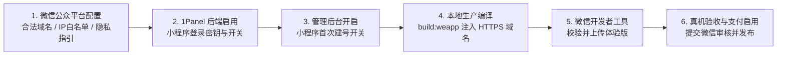

# 贵州众赢微信小程序生产上线完整指南

本指南基于本项目 Taro React 微信小程序与生产 API 域名 `https://api.guizhouzhongying.com`，覆盖微信公众平台配置、1Panel 线上后端登录与支付开关启用、本地生产构建、微信开发者工具上传体验版、真机验收与提审发布全流程。

**域名配置说明**：无需在业务源码中硬编码线上域名。[apps/miniapp/config/index.ts](../../apps/miniapp/config/index.ts) 在生产构建时通过环境变量 `TARO_APP_API_BASE_URL` 和 `TARO_APP_ASSET_BASE_URL` 注入源站，并强制校验生产环境必须以 `https://` 开头、末尾不带斜线、不带 `/api/v1`。

---

## 1. 上线全流程总览



---

## 2. 阶段一：微信公众平台后台配置

登录 [微信公众平台](https://mp.weixin.qq.com/)，核对当前小程序 AppID 与 [apps/miniapp/project.config.json](../../apps/miniapp/project.config.json) 中的公开配置一致，并逐项完成以下 4 项配置：

### 2.1 配置服务器合法域名

进入 **「开发管理 -> 开发设置 -> 服务器域名」**，配置以下三类合法域名（只填 HTTPS 源站，不带 `/api/v1` 或末尾斜线）：

| 配置项 | 填写值 | 用途 |
| --- | --- | --- |
| `request` 合法域名 | `https://api.guizhouzhongying.com` | 全部业务 API 与登录请求 |
| `uploadFile` 合法域名 | `https://api.guizhouzhongying.com` | 用户头像等图片上传 |
| `downloadFile` 合法域名 | `https://api.guizhouzhongying.com` | 商品图、分类图标、媒体资源加载 |

### 2.2 配置开发接口 IP 白名单与获取 AppSecret

进入 **「开发管理 -> 开发设置 -> 开发者 ID（AppSecret）」**：

- 若开启了 **IP 白名单**，必须将线上服务器公网出口 IP 加入白名单，否则后端调用微信 `stable_token` 与 `getuserphonenumber` 接口会被微信拒绝。
- 获取真实的 **AppSecret**，仅保存于服务端受控环境变量，禁止写入前端代码或提交仓库。

### 2.3 配置《用户隐私保护指引》

进入 **「设置 -> 服务内容声明 -> 用户隐私保护指引」**，按实际业务补全并提交审核：

- **收集你的手机号**：用于商城账号登录绑定、会员权益及到店核销/物业发分身份核验。
- **收集你选中的照片或视频信息 / 访问相册与相机**：用于个人头像上传、评价晒图及商家扫码核销。
- **读取你的剪切板**（如业务中使用了复制订单号或核销码）。

### 2.4 核对主体资质、手机号额度与微信支付权限

1. **手机号快速验证组件**：确认非个人主体已完成微信认证，且在「开发管理 -> 接口设置 / 付费管理」中手机号组件状态与额度正常。
2. **微信支付与发货管理（开启现金支付时核对）**：确认普通商户号与小程序 AppID 双向绑定、开通 JSAPI / 小程序支付权限、已切至 **微信支付公钥模式**，并核实微信发货信息管理权限。详细商户参数规范参见 [微信支付手册](wechat-pay.md)。

---

## 3. 阶段二：在 1Panel 开启线上后端小程序能力

### 3.1 生成 2 个全新的小程序独立密钥

在 1Panel **「主机 -> 终端」** 运行（每个至少 32 字节，彼此不同，且不得与已有的 4 个 Browser 密钥重复）：

```bash
python3 - <<'PY'
import secrets
print("MINIAPP_JWT_SECRET=" + secrets.token_urlsafe(48))
print("MINIAPP_TOKEN_HMAC_KEY=" + secrets.token_urlsafe(48))
PY
```

### 3.2 在 1Panel 更新 Python 运行环境变量

进入 **「网站 -> 运行环境 -> Python -> `guizhouzhongying-backend` -> 编辑 -> 环境变量」**：

#### 步骤 A：开启小程序登录与公开客服信息（本次上线必配）

```dotenv
MINIAPP_LOGIN_ENABLED=true
WECHAT_APP_ID=<你的小程序AppID>
WECHAT_APP_SECRET=<微信公众平台真实AppSecret>
MINIAPP_JWT_SECRET=<刚生成的MINIAPP_JWT_SECRET>
MINIAPP_TOKEN_HMAC_KEY=<刚生成的MINIAPP_TOKEN_HMAC_KEY>
# 可选：核实后的真实对外客服联系方式
SUPPORT_PHONE=<真实客服电话>
SUPPORT_EMAIL=<真实客服邮箱>
```

保存并重启 `guizhouzhongying-backend`，确认本机 `curl -sS http://127.0.0.1:18168/health/ready` 返回全绿。

#### 步骤 B：开启微信现金支付（建议体验版基础流程跑通后再配）

1. 将商户私钥 `apiclient_key.pem` 与微信支付公钥 `wechatpay_public.pem` 上传至服务器 `/srv/guizhouzhongying/secrets/wechat/`，文件权限设为 `0600`。
2. 在 `guizhouzhongying-backend` 的 **「挂载」** 选项卡新增只读挂载：宿主机 `/srv/guizhouzhongying/secrets/wechat` -> 容器 `/secrets/wechat`（只读）。
3. 在 **「环境变量」** 补齐普通商户公钥模式参数（建议先设 `WECHAT_PAY_RECOVERY_ENABLED=true`、`WECHAT_PAY_ENABLED=false` 验证客户端加载与回调可达，全部确认后再开启 `WECHAT_PAY_ENABLED=true`）：

   ```dotenv
   WECHAT_PAY_ENABLED=false
   WECHAT_PAY_RECOVERY_ENABLED=true
   WECHAT_PAY_MCH_ID=<普通商户号>
   WECHAT_PAY_MERCHANT_SERIAL_NO=<商户API证书序列号>
   WECHAT_PAY_PRIVATE_KEY_PATH=/secrets/wechat/apiclient_key.pem
   WECHAT_PAY_API_V3_KEY=<32位ASCII APIv3密钥>
   WECHAT_PAY_PUBLIC_KEY_ID=<PUB_KEY_ID_开头的微信支付公钥ID>
   WECHAT_PAY_PUBLIC_KEY_PATH=/secrets/wechat/wechatpay_public.pem
   WECHAT_PAY_NOTIFY_URL=https://api.guizhouzhongying.com/api/v1/payments/wechat/notify
   WECHAT_PAY_REFUND_NOTIFY_URL=https://api.guizhouzhongying.com/api/v1/refunds/wechat/notify
   WECHAT_PAY_CONFIG_VERSION=wechat-pay-v1
   WECHAT_SHIPPING_ENABLED=false
   WECHAT_SHIPPING_CARRIERS={}
   ```

4. 每次更新环境变量重启后端容器后，同步重启常驻 Worker，保证 Worker 读取最新配置：

   ```bash
   sudo systemctl restart guizhouzhongying-worker
   sudo systemctl status guizhouzhongying-worker --no-pager
   ```

5. 若 `api.guizhouzhongying.com` 开启了 1PWAF，必须给 `/api/v1/payments/wechat/notify` 与 `/api/v1/refunds/wechat/notify` 配置放行白名单。

---

## 4. 阶段三：在管理后台开启“小程序建号”并检查基础数据

**高频避坑**：后端 `MINIAPP_LOGIN_ENABLED=true` 仅控制微信身份换码总开关，新微信用户首次打开小程序静默建号还受管理后台的第二道开关控制（详见 [小程序身份与内容手册](miniapp-identity-and-content.md)）。

登录 `https://admin.guizhouzhongying.com` 完成以下 3 项检查：

1. **开启小程序建号**：进入 **「系统设置 -> 小程序建号」**，将允许首次建号设为 **开启** 并保存。
2. **核对分类与图片**：进入 **「商品中心 -> 商品分类」**，确认一级分类全部启用且图标显示正常。
3. **准备在售到店商品**：在 **「商家&物业 -> 商家管理」** 确认至少有 1 个启用商家，在 **「商品中心 -> 商品管理」** 确认有已上架、有库存且绑定该商家的到店商品。

---

## 5. 阶段四：本地执行生产构建

1. **先停止开发 watch 监听**：如果本地有正在运行的 `pnpm --filter @pinjie/miniapp dev:weapp` 终端，务必先按 `Ctrl + C` 停止，防止 watch 把生产构建出的 `dist/` 覆盖回开发版本。
2. 在仓库根目录执行生产构建：

   ```powershell
   $env:NODE_ENV = 'production'
   $env:TARO_APP_API_BASE_URL = 'https://api.guizhouzhongying.com'
   $env:TARO_APP_ASSET_BASE_URL = 'https://api.guizhouzhongying.com'
   pnpm --filter @pinjie/miniapp build:weapp
   ```

**说明**：

- 生产模式会自动关闭开发期路由轨迹日志（`__ROUTE_TRACE_ENABLED__ = false`），详见 [路由记录与上线配置指南](miniapp-route-trace-guide.md)。
- 编译产物输出在 `apps/miniapp/dist/`，禁止手工修改 `dist/` 内容。
- 每次修改源码或环境变量后都必须重新执行上述构建命令，只在微信开发者工具点击“编译”不会重新注入环境变量。

---

## 6. 阶段五：微信开发者工具校验与上传体验版

1. 打开 **微信开发者工具**，导入 `apps/miniapp` 目录（`project.config.json` 已设置 `"miniprogramRoot": "dist/"`）。
2. 打开右上角 **「详情 -> 本地设置」** 核对：
   - **必须取消勾选**：「不校验合法域名、web-view（业务域名）、TLS 版本以及 HTTPS 证书」（确保真实校验线上域名和证书）。
   - **保持开启**：「将 JS 编译成 ES5」「增强编译」「上传代码时样式自动补全」「上传代码时自动压缩混淆」。
   - **基础库版本**：使用 `3.17.4` 或最新稳定版（不低于 `3.5.5`）。
3. **预检确认**：
   - 清空 Console 重新编译，确认不再输出 `[路由轨迹]`。
   - 检查 Network 请求均指向 `https://api.guizhouzhongying.com`，无域名或 TLS 报错。
   - 在「详情 -> 基本信息 -> 本地代码」确认主包及各分包体积未超微信小程序 2MB 单包限制。
4. **上传并设为体验版**：
   - 点击工具栏 **「上传」**，填写版本号与更新备注。
   - 登录微信公众平台 **「管理 -> 版本管理」**，将该开发版选为 **「体验版」**，在 **「成员管理 -> 体验成员」** 添加测试微信号后扫码进入真机测试。

---

## 7. 阶段六：真机验收清单与提审发布

### 7.1 真机体验版必测清单

| 序号 | 测试场景 | 验收标准 |
| --- | --- | --- |
| 1 | 游客公开浏览 | 首页分类图、推荐商品、分类筛选、名称搜索与商品详情图文完整加载无裂图 |
| 2 | 静默建号与身份恢复 | 首次打开自动静默建号，杀掉微信重进恢复同一账号，管理后台可见自动初始化的账户、钱包与积分记录 |
| 3 | 一键登录与手机号授权 | 进入受限页跳转统一登录页，勾选协议点「微信登录」，通过隐私与手机号授权一次完成绑定并进入资料引导 |
| 4 | 资料与头像上传 | 上传头像、修改昵称保存，刷新后图片从 `https://api.guizhouzhongying.com/static/uploads/...` 正常展示 |
| 5 | 物业发分与积分购买 | 物业给买家发分 -> 买家使用积分抵扣下单，纯积分订单直接生成到店核销码二维码 |
| 6 | 商家扫码核销 | 商家扫码或输码预览并确认整单核销 -> 管理后台「商家结算」生成全额应收条目 |
| 7 | 未核销主动退款 | 未核销订单执行整单主动退款，积分返还与库存回补正常 |
| 8 | 微信现金支付（开启后） | 真实小额订单拉起收银台付款 -> 微信异步回调确认成交 -> 核销或退款走通闭环 |

### 7.2 提交审核与全量发布

1. 体验版全部验收通过后，在微信公众平台 **「管理 -> 版本管理 -> 体验版本」** 点击 **「提交审核」**。
2. 确认已添加与经营商品匹配的 **「商家自营」** 服务类目，并在提审备注写明体验流程，审核期间保持线上接口与在售商品可用。
3. 审核通过后点击 **「发布」** 全量上线；开启微信支付后记得在 1Panel「计划任务」配置每日微信日账单核对任务。

---

## 8. 常见问题与避坑速查表

| 序号 | 常见现象或报错 | 真实原因 | 解决办法 |
| --- | --- | --- | --- |
| 1 | 构建时报 `必须显式设置合法 API/资源源站` | 未设 `TARO_APP_API_BASE_URL`，或地址含 `http://`、末尾 `/`、`/api/v1` | 设为 `https://api.guizhouzhongying.com`（无尾部斜线与路径） |
| 2 | 真机报错 `request:fail url not in domain list` | 公众平台未配合法域名，或开发工具勾选了“不校验合法域名”掩盖问题 | 公众平台配齐 3 类合法域名，并在开发者工具取消勾选该项重测 |
| 3 | 体验版仍连 `127.0.0.1:18168` 或出现 `[路由轨迹]` | 未停止 `dev:weapp` 监听，或未执行 `NODE_ENV=production` 构建 | 停掉 `dev:weapp`，重新执行生产构建后再上传 |
| 4 | 新用户打开无法静默建号或登录 | 仅开启后端 `MINIAPP_LOGIN_ENABLED=true`，忘开后台建号开关 | 登录管理后台「系统设置 -> 小程序建号」开启开关 |
| 5 | 微信登录或手机号换码失败/超时 | `WECHAT_APP_SECRET` 错误，或服务器出口 IP 未加入公众平台白名单 | 核对 1Panel 环境变量与公众平台 IP 白名单，查看后端脱敏日志 |
| 6 | 真机点获取手机号或传头像无弹窗失败 | 未更新并审核通过《用户隐私保护指引》 | 在微信公众平台补齐手机号、相册与相机隐私声明 |
| 7 | 微信付款成功但订单仍待支付 | 微信回调被 WAF 拦截、Worker 未运行或商户公钥/APIv3 密钥配置有误 | 检查 `api.guizhouzhongying.com` 访问日志、放行回调并检查 Worker 状态 |
| 8 | 提审被拒：缺少类目或功能不完整 | 未配置「商家自营」类目或线上无已上架商品 | 补齐认证与服务类目，确保线上有真实在售商品 |
